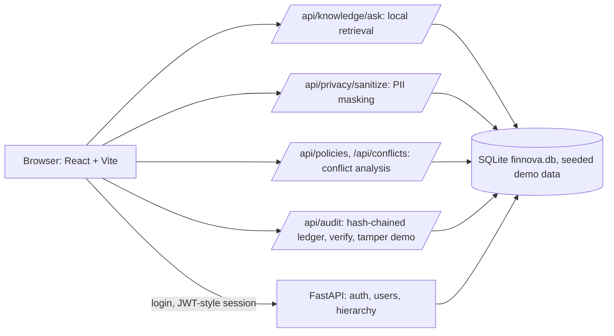

# FinNova - Privacy-First Enterprise Knowledge and Decision Intelligence

Capstone project: a role-based web platform that lets an organisation search its own policies and past decisions, understand *why* a decision was made, spot conflicting policies, and keep a tamper-evident audit trail, while keeping personal data out of the retrieval layer.

The app is a **React + TypeScript** front end with a **FastAPI** back end. Retrieval is local and deterministic (no external LLM is called), and the audit ledger is hash-chained with SHA-256.

**Links:** [GitHub](https://github.com/shriram-s7/Capstone-Enterprise-Knowledge-Management)

## Features

- **Role-based access** with six roles (Super Admin, Executive, Department Head, Manager, Employee, Auditor) and a dashboard per role.
- **Knowledge Assistant**: local retrieval over policies, practices and past decisions.
- **Ask Why**: explains the policy and decision trail behind an answer.
- **Conflict Resolver**: detects policy conflicts and records how they were resolved.
- **Privacy Center**: client-side PII sanitisation before queries are processed.
- **Audit ledger**: SHA-256 chained, verifiable audit events; security-event view for auditors.
- **Integrations and analytics**: demo connectors, KPIs and an "AI insights" summary page (Unified Intelligence).
- **Time Travel, Rule vs Reality Check and Question Shield**: policy version history, a compare-policy-to-practice view, and the privacy sanitiser demo (`src/pages`).
- **Authentication**: login, logout, change/forgot/reset password; passwords hashed with Argon2.

## How it works



The Knowledge Assistant never calls an external LLM: `retrieval_service.py` tokenises the question and ranks seeded policies, practices and decisions, then composes an answer with clause citations. The audit ledger chains each event's SHA-256 hash to the previous one, so `/api/audit/verify` can detect an edited entry; `/api/audit/tamper` and `/api/audit/restore` exist to demonstrate that. The front end carries a matching client-side copy of the sanitiser and chain verifier (`src/services`).

## Stack

| Layer | Technology |
|---|---|
| Front end | React, TypeScript, Vite, Tailwind CSS |
| Back end | Python, FastAPI, Uvicorn, Pydantic |
| Storage | SQLite (`backend/finnova.db`, created and seeded on first start) |
| Security | Argon2 password hashing, SHA-256 audit ledger |
| Tests | pytest (`backend/tests`) |

## Run it

Prerequisites: Python 3 and Node.js.

**Windows quick start:** run `start.bat`. It creates the backend virtual environment, installs dependencies, starts the API on http://127.0.0.1:8000 (docs at `/docs`) and the front end on http://localhost:5173.

**Manually:**

```bash
# Back end
python -m venv backend/venv
backend\venv\Scripts\activate
pip install -r backend/requirements.txt
python backend/run.py            # http://127.0.0.1:8000

# Front end (second terminal)
npm install
npm run dev                      # http://localhost:5173
```

Demo accounts are seeded on first start by `backend/app/auth/seed_users.py`; change them before any real use.

## Configuration

Copy `backend/.env.example` to `backend/.env` to override the defaults: `HOST`, `PORT`, `ENVIRONMENT`, `DATABASE_URL` and `CORS_ORIGINS`. `.env` files and databases are git-ignored.

## Tests

```bash
pytest backend/tests
```

Observed while writing this README: **26 passed** (about 4 s) in a fresh virtual environment with `backend/requirements.txt`. The front end has no tests; `npm run lint` and `npm run build` were not run.

## Layout

```
src/        React app (pages, components, context, demo data)
backend/    FastAPI app: auth, integrations, retrieval/privacy/audit/conflict services, tests
start.bat   Windows one-click launcher
```

## Status and limitations

- Working capstone prototype. All policies, practices, decisions and users are **seeded demo data** for a fictional company ("FinNova"); nothing connects to a real document store.
- Retrieval is keyword/rule based and some answers are templated for the seeded scenarios; it is not a trained model.
- The integrations page (connect/sync/KPIs/"AI insights") uses simulated connectors.
- Demo accounts are intentionally public sample logins (listed on the login page) and should be replaced before any real deployment.
- Single-process SQLite and a development server; no production hardening or front-end tests.

## License

No license specified.
